# M1 人物画像引擎整体交付报告

作者：valen MPF
日期：2026-10-16（Asia/Shanghai）

## 1. 执行范围与 Git 状态

仓库：`G:\codex\wechat-character-lab`
分支：`feature/p2b-workspace-updates`
执行前 HEAD：`072d6e9 feat(profile): 增加候选持久化模型与迁移`
远端跟踪：`origin/feature/p2b-workspace-updates`

既有未跟踪文件 `reports/p3-fe0-frontend-readiness.md`、`reports/p3-b2-1-r1-constraint-review.md` 已保留，未覆盖或清理。本阶段未读取、枚举或扫描 `data/`、`data/inbox/`，未读取真实聊天、音频、视频或凭据。

## 2. 既有实现复用

- `backend/app/profiles/jsonl_service.py`：规范化 JSONL 的安全门禁、显式角色映射、角色级 readiness、候选审核内存预览。
- `backend/app/profiles/synthetic_adapter.py`：证据 ID 唯一性、精确引用、正反证据和安全标记校验。
- `backend/app/profiles/jsonl_analyzer.py`：Observable/Fake/Disabled LLM analyzer contract。
- `backend/app/models/candidates.py` 与 migration `0004_profile_candidate_persistence.py`：snapshot/item/evidence/review event 候选层。
- `backend/app/models/profiles.py`、`backend/app/profiles/service.py`、`backend/app/api/profiles.py`：正式画像草稿、审核和发布流程。
- `ConversationOrchestrator`：仍按已批准正式画像向双角色 Agent 提供上下文；本阶段未改写会话编排。

## 3. 本阶段修改文件

### 生产代码

- `backend/app/profiles/candidate_persistence.py`：事务性候选快照、候选特征、supporting/counter evidence 写入；显式 JSONL ID 到 `ImportedMessage.id` 映射；缺失/不存在/角色不匹配/未批准来源分别记录 unmatched 或 invalid；`unmatched_evidence` 也持久化为不含正文的审计记录；重复快照幂等返回；异常回滚。
- `backend/app/profiles/candidate_review.py`：候选审核状态机、审核人/说明/原因码和 append-only review event 写入；条件 UPDATE 防止并发丢失更新。
- `backend/app/profiles/admission.py`：accepted 候选到正式 `ProfileVersion/ProfileTrait/ProfileEvidence` 的显式准入；保持 draft，不直接发布。
- `backend/app/profiles/consumer.py`：按角色和主题查询已批准正式画像，返回 readiness、认知状态、证据引用和 usage metadata；可记录 `profile.context_used` 事件。
- `backend/app/api/candidates.py`、`backend/app/schemas/candidates.py`：候选快照详情、审核、准入和画像上下文只读接口。
- `backend/app/models/candidates.py`：加入认知状态、推断依据、冲突状态和 unmatched evidence 审计表；匹配证据外键改为 `RESTRICT`。
- `backend/app/models/profiles.py`：正式画像保留认知状态/推断依据/冲突状态，并记录来源候选 item；来源候选唯一约束防止重复准入。
- `backend/app/db.py`、`backend/tests/conftest.py`：SQLite 显式启用 `PRAGMA foreign_keys=ON`。
- `backend/app/main.py`：注册候选路由。
- `backend/alembic/versions/0005_profile_engine_contracts.py`：候选认知字段、正式画像来源候选 FK、唯一约束、unmatched evidence 表和 `RESTRICT` 外键迁移，支持升级/降级。

### 测试

- `backend/tests/test_m1_profile_engine.py`：合成数据验证幂等、来源映射、审核/准入、消费上下文、删除前证据失效和 unknown 拒绝。
- `backend/tests/test_profiles.py`：补充 SQLite 外键启用后的 seed flush，保持既有正式画像测试语义。

## 4. 最终数据流

```mermaid
flowchart LR
  A[规范化 JSONL] --> B[安全门禁与显式角色映射]
  B --> C[Observable/Fake/Disabled Analyzer]
  C --> D[synthetic_adapter 严格证据回指]
  D --> E[CandidatePersistenceService]
  E --> F[Snapshot / Item / Evidence]
  F --> G[Candidate Review API]
  G --> H[Explicit Admission]
  H --> I[Formal ProfileVersion / Trait / Evidence draft]
  I --> J[现有正式审核与发布]
  J --> K[Profile Consumer Context]
  K --> L[M2 对话 Agent]
```



候选层与正式画像层保持隔离。候选 accepted 不等于正式 approved，也不等于已可用于对话；只有正式画像发布后，consumer 才返回可用上下文。

## 5. 认知状态和证据契约

| 状态 | 语义 | 最小约束 |
|---|---|---|
| `evidence_backed` | 可追溯的确定性观察 | 至少一条有效 supporting evidence；当前 `observable.*` 结果使用此状态 |
| `model_inferred` | 分析器推断，不能冒充直接观察 | 保存 `inference_basis`；仍需人工审核 |
| `unknown` | 证据不足或无法可靠判断 | 允许 NULL confidence；正式准入拒绝 |

`counter` evidence 永久保留。存在反向证据时，候选标记 `conflict`，正式准入拒绝，避免静默丢弃冲突。无效、未匹配和已失效 evidence 不计入有效支持。

## 6. 数据库约束问题及处理

P3-B.2.1-R1 已确认 `SET NULL + matched CHECK` 冲突。本阶段选择限制直接删除：`imported_message_id` 改为 `ON DELETE RESTRICT`。调用方必须先调用 `invalidate_imported_message_evidence()`，将 matched 显式变为 invalid 并清除正式映射，再删除 `ImportedMessage`。应用数据库、测试夹具和 Alembic SQLite 迁移连接现在显式启用外键，因此删除行为不再被测试配置掩盖。

角色 item 使用 `roles.id` 外键，当前未新增自动删除角色策略；删除角色前应由上层拒绝或先处理候选。snapshot 幂等摘要把 `role_scope` 与输入摘要一起规范化计算，角色范围变化不会复用错误快照。

## 7. 审核与正式准入

候选审核支持 `pending -> accepted/rejected/needs_review`，`needs_review` 可回到待处理状态；accepted/rejected 默认保持终态，重复请求幂等返回。审核事件记录前后状态、审核人、说明、原因码和时间。条件更新按旧状态保护并发审核。

正式准入会重新检查角色、approved source、matched supporting evidence、confidence、认知状态和冲突状态；通过后仅创建正式 `ProfileVersion(status=draft)`，并保留 `source_candidate_item_id`。现有正式审核/发布 API 仍负责最终接受和发布。

## 8. M2 消费接口

内部接口：

```python
context = build_role_context(db, "role_a", topic="observable", session_id=session_id)
```

HTTP 接口：

```text
GET /api/candidate/context/{role_id}?topic=<optional>&session_id=<optional>
```

返回 `readiness`：`ready`、`partial` 或 `insufficient_samples`；包括正式画像版本、特征 ID、认知状态、confidence、证据引用摘要和检索依据。查询时会重新验证 evidence 对应消息仍属于目标角色且 source 仍为 `approved`，来源撤销后 readiness 降为 `partial`。使用时只记录角色、版本、trait IDs 和 retrieval basis，不记录正文。尚无批准画像时明确返回 `insufficient_samples`，不会静默回退为画像驱动成功。

## 9. Chat2Profile 与 ChatAnalysis.SKILL 状态

当前仓库和本地 Skills 目录没有可运行的 Chat2Profile 或 ChatAnalysis.SKILL 源码入口。本地已有 P2 审查报告记录候选公开仓库和风险，但本阶段没有下载、安装或执行它们，也未把 README 能力描述当成验证结果。因此本阶段继续使用 Observable/Fake/Disabled provider；真实 LLM 默认关闭。下一步若接入，必须先固定 commit、核实实际 LICENSE/依赖，并把外部输出通过现有 evidence ID adapter 校验后才能进入候选层。

## 10. 实际验证命令

| 命令 | 结果 |
|---|---|
| `backend\\.venv\\Scripts\\python.exe -m pytest -q backend/tests/test_migrations.py` | 3 passed, 6 warnings |
| `backend\\.venv\\Scripts\\python.exe -m pytest -q backend/tests/test_m1_profile_engine.py` | 4 passed, 2 warnings |
| `backend\\.venv\\Scripts\\python.exe -m pytest -q backend/tests/test_migrations.py backend/tests/test_m1_profile_engine.py backend/tests/test_profiles.py` | 14 passed, 6 warnings |
| `backend\\.venv\\Scripts\\python.exe -m pytest -q backend/tests --ignore=backend/tests/test_imports.py` | 106 passed, 6 warnings |
| `backend\\.venv\\Scripts\\ruff.exe check backend\\app backend\\tests` | All checks passed |
| `git diff --check` | 通过 |

警告均为既有 Starlette/httpx、pytest-asyncio 和 Alembic `path_separator` deprecation warning。未运行 `backend/tests/test_imports.py`，未连接真实数据库，未运行真实数据导入、LLM、ASR、TTS 或语音克隆。

## 11. 未解决问题和风险

- 候选持久化服务目前接收调用方提供的 `input_digest`、`analyzer_digest` 和 source mapping；生产导入层仍需建立可信的 dataset identity 与 mapping service。
- Review event 的只追加语义由业务服务约束，数据库没有 trigger 阻止人工 SQL UPDATE/DELETE。
- 正式画像模型仍要求非空 confidence；因此 unknown/model-inferred 候选不能直接准入，需人工补充和审核。
- Chat2Profile/ChatAnalysis.SKILL 尚未接入；当前语义候选仍是 Fake provider 或后续外部适配接口，不代表真实语义理解已完成。
- 本阶段没有实现 ZIP/Inbox 到候选服务的自动连接，也没有读取真实数据验证字段契约。

进入真实小样本前置条件：完成 source/message mapping 服务、真实字段脱敏样本契约、审核 UI/API 联调、并在隔离数据库验证完整准入回滚路径。

## 12. M2 复用说明

M2 只需在对话编排前调用 `build_role_context()`，将返回的结构化特征和 readiness 传给 Role Agent；每轮会话携带 `profile_version_id` 与 `trait_ids`，并由 `record_context_usage()` 记录使用依据。M2 不应直接读取候选表、不应把 pending/unknown/counter 冲突特征拼入角色提示词，也不应绕过正式画像审核和发布门槛。
