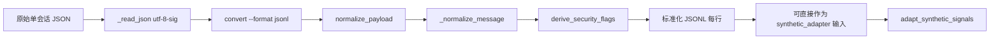

# P2-D.1 导入源字段契约与双路径兼容性审计

作者：valen MPF
日期：2026-10-16（Asia/Shanghai）

## 1. 审计范围与边界

本阶段仅进行源码、测试和已有报告审计，并用一条人工合成输入复核一个来源覆盖风险。未读取、枚举或扫描 `data/`、`data/inbox`，未读取真实聊天正文、图片、语音、视频或凭据；未运行 `backend/tests/test_imports.py`，未调用网络/API/LLM，未安装依赖，未执行真实画像或语音流程。

未覆盖的指定文件：`reports/p0-preflight.md` 未找到；实际存在并阅读的是 `reports/preflight.md`。`backend/tests/test_converter_bom.py` 已找到并阅读。

## 2. 实际检查文件

### 源码与测试

- `scripts/convert_wechatauto_export.py`
- `backend/app/ingestion/wechat_normalizer.py`
- `backend/app/ingestion/security_flags.py`
- `backend/app/profiles/synthetic_adapter.py`
- `backend/app/ingestion/archive_parser.py`
- `backend/app/ingestion/normalizer.py`
- `backend/app/api/imports.py`
- `backend/app/schemas/message.py`
- `backend/app/models/imports.py`
- `backend/tests/test_security_flags.py`
- `backend/tests/test_wechat_normalizer.py`
- `backend/tests/test_synthetic_adapter.py`
- `backend/tests/test_converter_bom.py`
- `backend/tests/test_imports.py`（静态阅读，未执行）

### 报告

- `reports/preflight.md`
- `reports/p1-data-normalization.md`
- `reports/p2-c2-security-flags-contract.md`
- `reports/p2-c2.1-security-flags-review.md`

## 3. 两条实际数据流

### 路径 A：JSONL 规范化路径



**已确认事实：** `scripts/convert_wechatauto_export.py:148-160` 的 `--format jsonl` 调用 `normalize_payload`；`wechat_normalizer.py:76-137` 生成 `message_id`、时间、角色、正文、媒体类型和安全字段；`wechat_normalizer.py:104-112` 调用 `derive_security_flags`；`synthetic_adapter.py:73-176` 才会消费带 `message_id` 的标准化字典。该路径不等于数据库导入 API 路径。

### 路径 B：ZIP `convert()` 与 Inbox 导入路径


**已确认事实：** `convert():24-124` 不调用 `normalize_payload`，而在 `:41-95` 独立要求时间、发言人、文本和两种发言人，生成 `external_id/speaker_label/text/sent_at` 等字段并写入 ZIP `messages.json`。`archive_parser.py:19-89` 只把通用字段映射到 `NormalizedMessage`，未识别字段进入 `metadata`；`api/imports.py:145-211` 将结果写入 `ImportedMessage`。当前 `profiles.service.create_draft` 使用已审核的 `ImportedMessage`，没有把 `synthetic_adapter` 接入该数据库链路。

### 分叉位置与字段丢失点

1. `convert --format jsonl` 在 `:148` 分支调用 `normalize_payload`；默认 ZIP 在 `:162` 调用独立 `convert()`。
2. ZIP `convert()` 只输出 `messages.json` 的 Inbox 通用契约，不输出 `message_id`、`timestamp_status`、`content_status`、`source_message_ref` 或安全字段。
3. `archive_parser` 将 `message_type/type_code/sender_id/local_id/server_id/sort_seq` 等未列入 `known_fields` 的内容放进 `metadata`，不会还原为 JSONL 顶层字段。
4. `ImportedMessage` 只有 `external_id`、`speaker_label`、`speaker_role_id`、`text`、`sent_at` 和 `metadata_json`；没有安全标记列，也没有 JSONL 的 `message_id`/`timestamp_status` 契约。

## 4. 字段契约对照表

| 字段 | JSONL 路径来源与行为 | ZIP/Inbox 路径来源与行为 | 画像/审计结论 |
|---|---|---|---|
| `message_id` | `local_id/server_id` 组成 `wechat:<local>:<server>`；无 ID 时使用确定性 JSON SHA-256 前 24 位；同来源碰撞追加 `#2` 等（`wechat_normalizer.py:76-85,50-55`）。 | `convert()` 生成 `external_id`，格式含 `sort_seq/local_id/server_id/index`；解析后是 `NormalizedMessage.external_id`，不是 `message_id`（`convert...:64-73`、`archive_parser.py:61-78`）。 | 可追溯但两条路径 ID 语义不等价；不能直接把 ZIP `external_id` 当 JSONL `message_id` 供适配器使用。 |
| `source_local_id` | 原始 `local_id` 经 `_optional_scalar`；缺失为 `None`，非法标量转字符串（`wechat_normalizer.py:76-80,152-157`）。 | ZIP 中写入 `local_id`，随后进入 `metadata`；没有顶层字段。 | 可在 JSONL 使用；ZIP 只能从 metadata 取，需显式适配。 |
| `source_server_id` | 原始 `server_id`，规则同上。 | ZIP 中写入 `server_id`，随后进入 `metadata`。 | 同上。 |
| `timestamp` | 原始 `create_time` 转 UTC ISO 字符串；缺失/非法/越界返回 `None`，并写 `timestamp_status`（`wechat_normalizer.py:91,142-149`）。 | 写为 `sent_at` ISO 字符串；缺失或不可转整数直接使 `convert()` 失败（`convert...:44-49,80`）；解析后成为 `datetime | None`。 | 时间可进入各自路径，但字段名、失败策略和类型不一致。 |
| `timestamp_status` | `parsed_utc/missing/invalid/out_of_range`，保留原始值 `timestamp_raw`。 | 无该字段；`archive_parser` 只有成功解析/抛出 `ArchiveParseError` 两类结果。 | 时序画像适配器无法直接消费 ZIP/DB 记录。 |
| `sender` | `sender_name` 脱空白，缺失为 `None`（`wechat_normalizer.py:92,169-170`）。 | `speaker_label` 来自 `sender_name`，本人按 `nick_name` 替换为“我”；解析后为必填 `speaker_label`。 | 语义相近但角色名称可能变化；必须使用显式映射。 |
| `sender_id` | 保留在 `source_metadata.sender_id`，不成为顶层字段（`wechat_normalizer.py:132-137`）。 | ZIP 顶层 `sender_id`，解析后进入 `metadata`。 | 可审计性依赖 metadata，字段位置不一致。 |
| `message_type` | `type_code` 映射到 `text/image/voice/video/contact/emoji/location`，未知为 `unknown:<code>`；保留 `source_type_code`。 | ZIP 写原始 `type` 到 `message_type`，不按 `TYPE_NAMES` 映射；解析后因不在 `known_fields` 进入 metadata。 | 类型值和位置不一致；不能据此直接判断普通文本资格。 |
| `content` | 原始字符串保留；`None` 或非字符串不猜测，分别为 `missing/not_text`；空字符串为 `empty`。 | 原始 `content` 必须为字符串；空字符串被替换为 `[类型]` 占位符，并另存 `content_was_empty`。解析后字段名为 `text`。 | ZIP 会改变空正文语义；媒体/空消息不能等价于文本证据。 |
| `content_status` | `present/empty/missing/not_text`。 | 无该字段；只有 `content_was_empty`。 | 画像适配器依赖该字段，ZIP/DB 记录不能直接进入。 |
| `source_file` | 调用方传入，JSONL 输出保留。 | 无消息级 `source_file`；来源相对路径保存在 `Source.metadata_json.relative_path`。 | 审计粒度不同。 |
| `source_message_ref` | `messages[行号]`，可回指原始 JSON 行。 | 无同名字段；`archive_parser` 仅添加 `metadata.source_row`。 | 可追溯但命名和位置不一致。 |
| `is_ai_generated` | `derive_security_flags` 输出 `bool | None`；只接受原生布尔或精确 AI 类型标记。 | `convert()` 不输出；ZIP/Inbox/DB 无顶层字段。 | ZIP 路径无法满足适配器安全门槛。 |
| `is_system` | 同上；精确 `system` 类型可确认 `True`，不能从普通消息推断 `False`。 | `convert()` 不输出；无顶层字段。 | 同上。 |
| `security_flag_sources` | 输出稳定来源映射，记录显式、类型、unknown、invalid/conflict 依据。 | 不输出；`archive_parser` 不会生成。 | ZIP 路径缺少安全审计证据。 |

### 字段缺失与可靠性原则

- **可可靠确定：** JSONL 中显式原生布尔值、精确类型标记、有效时间范围、来源 ID/哈希 ID、消息类型映射和原始文本状态。
- **必须保持 unknown：** 普通文本、普通昵称、常见 `type_code` 对“不是 AI/不是系统”的否定判断；缺失、非法或冲突安全来源。
- **必须拒绝或不进入画像：** ZIP/DB 中缺少两个布尔安全字段的消息；媒体或空正文；角色未映射；证据 ID 不唯一/不存在；严格时序证据缺少 `parsed_utc` 或时区。
- **来源审计限制：** JSONL 输出的 `security_flag_sources` 记录了来源类别，但 `record.source_metadata` 不保留输入中的完整安全字段；ZIP 路径连来源类别也没有。

## 5. 安全标记审查结论

### 已确认事实

1. `security_flags.py:35-79` 对每个字段分别执行三态推导；显式字段和 `source_metadata` 同名字段必须为原生 `bool`，冲突为 `None`。
2. `security_flags.py:106-137` 只识别 `ai/assistant/system` 类型，多个类型类别冲突时返回稳定的 `conflict:type_markers:*`。
3. `synthetic_adapter.py:237-278` 要求两个安全字段存在且是真正 `bool`；`None`、非法值、`True` 或媒体/非文本均不能形成普通候选。
4. `synthetic_adapter.py:280-293` 的时序校验要求 `timestamp_status == "parsed_utc"`、可解析且带时区。

### 已复现风险

人工合成输入含顶层 `type="text"` 和 `source_metadata.type="system"` 时，`wechat_normalizer.py:104-112` 先用 `security_metadata.update(type=..., message_type=...)` 覆盖了 metadata 的同名类型；输出为 `is_system=None`、`unknown:no_reliable_source`，没有保留该冲突证据。该结果由本地合成命令复现，未接触真实数据。

**分类：** 已确认的来源保留/冲突审计缺陷，当前阶段不修复。它不会放宽安全门禁，但可能把一个应标记为“冲突/unknown”的消息降级为普通 unknown，降低审计可解释性。建议下一阶段先保留原始类型来源，再调用 enrichment，并增加规范化器冲突测试。

### 未发现的绕过

未发现通过默认 `False` 绕过安全门禁的代码路径。真正的风险是 ZIP 路径没有生成字段，导致直接进入 `synthetic_adapter` 时被拒绝；当前数据库画像服务并未使用 `synthetic_adapter`，因此不能宣称数据库画像链路已具备同等安全校验。

## 6. 现有测试覆盖矩阵

| 检查项 | 状态 | 证据 |
|---|---|---|
| JSONL 标准化字段、稳定 ID、时间和来源引用 | 已覆盖 | `test_wechat_normalizer.py:18-73` |
| JSONL 显式/unknown/非法/冲突安全标记 | 已覆盖 | `test_security_flags.py:22-180` |
| unknown、AI、system 的适配器资格 | 已覆盖（合成路径） | `test_security_flags.py:183-250`、`test_synthetic_adapter.py:312-334` |
| 证据 ID、角色、引文、正反证据和时序拒绝 | 已覆盖（合成路径） | `test_synthetic_adapter.py:202-399` |
| JSON 输入 BOM 与 JSONL 重复性 | 已覆盖 | `test_converter_bom.py:43-74` |
| ZIP BOM、ZIP CRC 和消息数 | 已覆盖 | `test_converter_bom.py:77-105` |
| ZIP 与 JSONL 核心字段等价 | 未覆盖 | 两个 converter 分支没有等价性断言 |
| ZIP 输出安全字段 | 未覆盖且当前实现缺失 | `convert():75-89` 无三个安全字段 |
| ZIP → archive_parser → ImportedMessage 安全字段传递 | 未覆盖且当前实现缺失 | `archive_parser.py:61-89`、`models/imports.py:29-41` |
| ZIP `message_id/timestamp_status/content_status/source_message_ref` 契约 | 未覆盖且字段不存在 | ZIP 独立 schema |
| 规范化器 raw `source_metadata` 类型冲突保留 | 未覆盖，已复现缺陷 | `wechat_normalizer.py:104-112` |
| 来源 ID 缺失、重复、碰撞 | 部分覆盖 | JSONL 碰撞覆盖；ZIP external_id 行号兜底和 DB 唯一性有测试，但跨路径等价未覆盖 |
| 正文缺失、媒体、非文本 | 部分覆盖 | JSONL/adapter 合成覆盖；ZIP 空正文被占位，等价行为未覆盖 |
| 真实 WeChatBridge 字段 | 未确认 | 当前代码仅支持公开通用归档契约，未连接私有 Bridge API |

## 7. 下一阶段前置条件

### 是否可以离线验证真实导入格式？

**可以，但仅限于用户提供的脱敏 JSON/ZIP 小样本。** `_read_json`、`normalize_payload`、`convert` 和 `archive_parser` 都是本地代码，不需要外部服务。当前只能验证“文件是否符合项目契约”，不能据此证明未知 WeChatBridge 私有格式自动兼容。

### ZIP 路径最小兼容方案（建议，不在本阶段实施）

1. 选择单一规范化入口：默认 ZIP `convert()` 先生成与 JSONL 相同的标准化消息记录，再由一个独立 serializer 输出 Inbox 兼容 `messages.json`；避免两套字段推导逻辑继续分叉。
2. 若必须保留当前 ZIP Inbox schema，增加独立 enrichment：在 `archive_parser`/导入确认前把 `external_id→message_id`、`sent_at→timestamp + parsed_utc`、`speaker_label→sender`、`text→content + content_status` 映射，并显式生成/保留 `is_ai_generated`、`is_system`、`security_flag_sources`；来源不足时保留 `None`，不得默认 `False`。
3. 在真正进入画像前设置安全闸门：缺少两个原生布尔字段的 ZIP/DB 消息只能进入待审核/非画像集合，不能直接进入普通候选。
4. 为两条路径增加同义合成输入对照测试，比较核心字段、ID 语义、时间状态、文本状态和安全来源；测试不使用真实数据。
5. 修复规范化器类型来源覆盖：保留顶层 `type`、原始 `source_metadata.type` 和规范化 `message_type` 的独立来源，再调用 `derive_security_flags`。

### 必须完成的前置条件

- 明确 ZIP 与 JSONL 的唯一 canonical message contract 和 ID 语义。
- 决定安全字段未知时是拒绝画像、进入待审核还是允许非画像存储；当前适配器策略是拒绝。
- 完成 ZIP 路径安全字段 enrichment 和来源审计记录。
- 增加 ZIP→parser→DB→画像边界的合成测试，不扫描 `data/`。
- 对 WeChatBridge/wechatauto 导出的字段进行人工确认：安全标记、消息类型、消息 ID、空正文和媒体占位的真实含义。
- 用最小脱敏样本验证角色映射、重复 ID、时间、正文/媒体和安全标记冲突，再决定是否进入真实小样本。
- 保持原始聊天和媒体只读，输出写入独立目录；继续禁止默认 `False`。

## 8. Git 状态与执行记录

执行前及报告生成前的工作区状态：

```text
## feature/p2b-workspace-updates
 M backend/alembic/env.py
 M backend/app/ingestion/wechat_normalizer.py
 M backend/app/profiles/synthetic_adapter.py
 M backend/tests/test_contracts.py
 M backend/tests/test_migrations.py
 M backend/tests/test_synthetic_adapter.py
 M findings.md
 M progress.md
 M task_plan.md
?? backend/app/ingestion/security_flags.py
?? backend/tests/test_security_flags.py
?? reports/p2-b2-validation.md
?? reports/p2-b3-regression-stability.md
?? reports/p2-c-synthetic-e2e-validation.md
?? reports/p2-c1-mock-topic-contract.md
?? reports/p2-c2-security-flags-contract.md
?? reports/p2-c2.1-security-flags-review.md
?? reports/p2-d1-ingestion-contract-audit.md
```

本阶段新增文件仅为本报告；未修改生产代码、数据库迁移、Mock Agent 或第三方源码，未提交、未推送、未清理既有工作区修改。

实际执行的合成复核命令：

```text
@' ... normalize_payload(人工合成 payload) ... '@ | .\\venv\\Scripts\\python.exe -
```

结果：顶层 `type="text"` 与 `source_metadata.type="system"` 的冲突来源被覆盖，输出 `is_system=None`、`unknown:no_reliable_source`；这是本报告记录的已复现风险。未执行 pytest、导入扫描或真实数据命令。

## 9. 结论

当前代码具备对 JSONL 标准化路径进行离线、合成和安全门槛验证的条件，但不具备把 ZIP `convert()` 路径直接视为同等画像输入的条件。JSONL 路径的安全字段和适配器契约已形成；ZIP/Inbox/SQLite 路径仍是另一套消息 schema，缺少安全字段和多个追溯字段。进入脱敏小样本人工验证前，必须先统一 canonical contract、补齐 ZIP enrichment、修复来源覆盖并完成跨路径合成测试。

P2-D.1 完成，停止等待人工审核；不自动进入真实数据处理、数据库/API 开发或语音流程。
