# P3-B.1 画像候选持久化数据契约设计

作者：valen MPF
项目：`wechat-character-lab`
分支：`feature/p2b-workspace-updates`
审查范围：JSONL 角色特征候选与现有正式画像持久化边界
日期：2026-10-16（Asia/Shanghai）

## 1. 执行摘要

本阶段完成只读代码审查和候选持久化契约设计，没有修改生产代码、数据库模型、Alembic migration 或 REST API，也没有读取 `data/`、真实聊天、媒体或凭据。

结论：推荐 **方案 B：独立候选层（Candidate Layer）**。JSONL 分析结果先以候选快照、来源消息映射、正反证据和审核审计记录保存；只有在人工接受后，经过来源消息重新解析、角色和安全门禁复核，才允许转换为现有正式 `ProfileVersion` / `ProfileTrait` / `ProfileEvidence`。

不能把 JSONL 的 `message_id` 直接写入正式 `ProfileEvidence.message_id`。正式表的该字段外键指向 `imported_messages.id`，而 JSONL 的 ID 只在输入数据集内稳定，二者身份语义不同。

## 2. 执行信息与边界

### 2.1 Git 状态

- 当前分支：`feature/p2b-workspace-updates`
- 执行前 HEAD：`4caaadc fix(profile): 修正 JSONL 画像状态聚合`
- 远端跟踪：`origin/feature/p2b-workspace-updates`
- 执行前工作区：干净；本地相对远端领先 1 个既有提交
- 本阶段目标修改：仅新增本报告

### 2.2 已检查文件

- `AGENTS.md`
- `backend/app/models/profiles.py`
- `backend/app/models/imports.py`
- `backend/app/profiles/jsonl_service.py`
- `backend/app/profiles/jsonl_analyzer.py`
- `backend/app/profiles/synthetic_adapter.py`
- `backend/app/profiles/service.py`
- `backend/app/schemas/profile.py`
- `backend/app/api/profiles.py`
- `backend/tests/test_jsonl_profile_generation.py`
- `backend/tests/test_synthetic_adapter.py`
- `backend/tests/test_profiles.py`
- `backend/tests/test_api.py`
- `reports/p3-a-profile-generation-mvp.md`
- `reports/p3-a1-readiness-semantics.md`

### 2.3 未执行事项

本阶段没有读取 `data/` 或真实导出内容，没有调用外部 API/LLM，没有安装依赖，没有运行真实画像、ASR、TTS 或语音克隆，没有修改现有代码和测试。

## 3. 当前正式画像模型与调用链

### 3.1 现有模型事实

| 模型 | 关键字段 | 当前语义 |
|---|---|---|
| `Source` | `id`, `kind`, `name`, `status`, `metadata_json` | 导入源及其审核状态；正式分析只应使用 `status=approved` |
| `ImportedMessage` | `id`, `source_id`, `external_id`, `speaker_label`, `speaker_role_id`, `text`, `sent_at`, `metadata_json` | 规范化后的数据库消息；`(source_id, external_id)` 唯一 |
| `ProfileVersion` | `id`, `role_id`, `version`, `status`, `analyzer`, `sample_count` | 角色画像草稿/已批准/历史版本；`(role_id, version)` 唯一 |
| `ProfileTrait` | `id`, `profile_version_id`, `category`, `trait_key`, `description`, `confidence`, `review_status`, `reviewer_note` | 已进入正式画像版本的特征；`confidence` 非空 |
| `ProfileEvidence` | `id`, `trait_id`, `message_id`, `rationale` | 正式特征证据；`message_id` 强制外键到 `ImportedMessage.id`，同一特征不可重复引用同一消息 |

证据模型位置：`backend/app/models/profiles.py:18-68`。导入模型位置：`backend/app/models/imports.py:6-39`。

### 3.2 当前正式调用链

```mermaid
flowchart TD
    A[POST /api/roles/{role_id}/profiles/analyze] --> B[profiles.service.create_draft]
    B --> C[Source.status = approved]
    C --> D[ImportedMessage.speaker_role_id = role_id]
    D --> E[ObservableTextAnalyzer]
    E --> F[ProfileVersion draft]
    F --> G[ProfileTrait pending]
    G --> H[ProfileEvidence.message_id = ImportedMessage.id]
    H --> I[人工 review API]
    I --> J[POST /publish]
    J --> K[approve_version 复核证据与来源]
    K --> L[ProfileVersion approved]
```

`create_draft()` 在 `backend/app/profiles/service.py:13`，只查询已批准来源和指定角色的 `ImportedMessage`，过滤文字消息后直接建立正式草稿。`approve_version()` 在 `backend/app/profiles/service.py:90`，要求所有特征已审核、至少一项 accepted，并再次检查 accepted 特征的证据属于目标角色且来源仍为 approved。

现有正式 API 位于 `backend/app/api/profiles.py:20-83`：分析、列表、详情、特征审核和发布。现有 schema 只支持 `pending/accepted/rejected`；没有候选层的 `needs_review`、来源数据集 ID 或审核事件历史。

## 4. JSONL 候选链路事实

### 4.1 当前输入与输出

`analyze_normalized_messages()` 位于 `backend/app/profiles/jsonl_service.py:75`。它只处理调用方传入的内存规范化消息，不读取文件或数据库。

处理顺序为：

1. 校验显式 `sender_role_map`，只允许 `role_a` / `role_b`。
2. 重新验证安全标记来源和安全门禁。
3. 排除重复消息 ID、未映射 sender、AI/system、媒体、空正文和非文本消息。
4. 按显式角色映射分组，并以确定性顺序调用 Analyzer。
5. 用 `adapt_synthetic_signals()` 做候选信号、证据 ID、引文、角色和时间校验。
6. 返回 `JsonlProfileResult`，其中候选包装为 `ReviewedCandidate`。

`JsonlProfileResult` 当前字段：`snapshot_id`、`status`、`role_statuses`、`sample_counts`、`analyzer_statuses`、`candidates`、`unmatched_evidence`。定义在 `backend/app/profiles/jsonl_service.py:52`。

### 4.2 当前候选字段

底层 `ProfileCandidate`（`backend/app/profiles/synthetic_adapter.py`）包含：

- `profile_item_id`
- `subject_id`
- `category`
- `claim`
- `evidence_refs`
- `confidence`
- `counter_evidence_refs`
- `observed_at`
- `updated_at`

`ReviewedCandidate` 额外包含 `analyzer_name`、`analyzer_version`、`review_status` 和 `reviewer_note`。其审核操作 `review_candidate()` 以及角色配置预览 `build_role_config_preview()` 目前均为内存快照，不创建数据库记录；预览固定 `publishable=False`。

### 4.3 JSONL 数据流

```mermaid
flowchart LR
    A[规范化 JSONL record] --> B[parse_normalized_jsonl]
    B --> C[analyze_normalized_messages]
    C --> D[安全门禁与显式 sender_role_map]
    D --> E[Observable/Fake/Disabled Analyzer]
    E --> F[合成 signal]
    F --> G[adapt_synthetic_signals]
    G --> H[ProfileCandidate + ReviewedCandidate]
    H --> I[内存审核与 config preview]
    I --> J[候选持久化层：本阶段设计]
    J --> K[解析到 ImportedMessage.id]
    K --> L[正式 ProfileVersion/ProfileTrait/ProfileEvidence]
```



## 5. 来源消息 ID 映射契约

### 5.1 身份区分

| 标识 | 所在层 | 语义 | 可否直接作为正式 `ProfileEvidence.message_id` |
|---|---|---|---|
| `source_dataset_id` | 候选快照 | 本次 JSONL 数据集/导入批次的稳定身份 | 否 |
| `source_message_id` | 候选证据 | 规范化 JSONL 内的唯一 `message_id` | 否，除非显式映射结果确认它就是 DB 主键 |
| `source_local_id` / `source_server_id` | 原始来源元数据 | 外部系统的本地/服务端标识 | 否 |
| `imported_message_id` | 正式数据库 | `ImportedMessage.id` 主键 | 是 |

候选层必须同时保留 `source_dataset_id` 和 `source_message_id`。正式准入后新增明确的 `imported_message_id`，不能覆盖或改写原始 JSONL 引用。

### 5.2 三种映射情况

**情况 A：已知数据库主键映射**

- 候选记录含 `source_dataset_id` + `source_message_id`。
- 映射表明确给出唯一 `imported_message_id`。
- 目标 `ImportedMessage` 存在，且所属 `Source.status=approved`、`speaker_role_id` 与候选 `subject_id` 一致。
- 允许进入正式证据转换，但仍须重新执行正文、消息类型、安全标记和角色校验。

**情况 B：只有来源外部键**

- 通过 `(source_id, external_id)` 找到唯一 `ImportedMessage`。
- 必须由受信任的导入批次提供 `source_id`，不能仅凭昵称、正文或时间猜测。
- 找不到、找到多条或外部键冲突时，候选保持 `unmatched`，不得入库为正式证据。

**情况 C：只有 JSONL `message_id`**

- 只保存为候选层 `source_message_id`。
- 不能直接写入 `ProfileEvidence.message_id`。
- 候选可以进入审核队列，但不能进入已发布正式画像。

## 6. 推荐候选持久化契约（方案 B）

本阶段只定义契约，不实施 migration。建议新增独立候选命名空间，避免污染现有正式画像表。

### 6.1 候选快照

建议实体：`ProfileCandidateSnapshot`

| 字段 | 类型/约束 | 说明 |
|---|---|---|
| `id` | UUID/String 主键 | 候选快照 ID；对应当前一次输入和分析器集合 |
| `source_dataset_id` | String，非空 | JSONL 数据集/批次身份 |
| `role_scope` | JSON，非空 | 本次显式分析角色集合 |
| `analyzer_manifest` | JSON，非空 | Analyzer name/version/status 的确定性清单 |
| `input_digest` | String，非空 | 脱敏输入结构摘要，不保存原文 |
| `status` | `draft/under_review/accepted/rejected/expired` | 快照生命周期 |
| `created_at` / `updated_at` | DateTime | 审计时间 |

### 6.2 候选特征

建议实体：`ProfileCandidateItem`

| 字段 | 类型/约束 | 说明 |
|---|---|---|
| `id` | UUID/String 主键 | 候选记录数据库 ID |
| `snapshot_id` | FK | 所属快照 |
| `profile_item_id` | String，唯一作用域为 snapshot | 当前候选快照内的稳定 ID，不等同长期 trait ID |
| `subject_id` | `role_a/role_b` | 显式角色映射结果 |
| `category` / `claim` | 非空文本 | 特征类别和描述 |
| `confidence` | Float 或 NULL | 缺失时保持 NULL/unknown，不自动填高置信度 |
| `observed_at` / `updated_at` | 可空时间/版本标识 | 观测语义，不作为 DB 审核时间替代 |
| `analyzer_name` / `analyzer_version` | 非空文本 | 生成来源 |
| `review_status` | `pending/accepted/rejected/needs_review` | 候选审核状态 |
| `reviewer_note` | 可空文本 | 人工说明 |
| `candidate_fingerprint` | String，非空 | 输入、分析器和候选内容的稳定指纹 |

### 6.3 候选证据

建议实体：`ProfileCandidateEvidence`

| 字段 | 类型/约束 | 说明 |
|---|---|---|
| `id` | UUID/String 主键 | 候选证据记录 ID |
| `candidate_id` | FK | 候选特征 |
| `direction` | `supporting/counter` | 正向或反向证据 |
| `source_dataset_id` | String，非空 | 来源数据集 |
| `source_message_id` | String，非空 | JSONL 原始规范化消息 ID；原样保留 |
| `imported_message_id` | String，可空 FK | 只有解析成功后才填写 |
| `quote_digest` | String，可空 | 引文摘要/哈希；不保存完整正文 |
| `rationale` | 非空 | 分析器或审核说明 |
| `match_status` | `unmatched/matched/invalid` | 映射状态 |
| `matched_at` | 可空时间 | 映射审计时间 |

约束：同一候选中相同 `source_message_id` 不能同时出现在 `supporting` 与 `counter`；证据引用必须唯一、可回指、精确匹配。不能通过删除无效证据让候选绕过校验。

## 7. Confidence 契约

当前 JSONL adapter 允许 `confidence=None` 表示 unknown；当前正式 `ProfileTrait.confidence` 为非空 `Float`，schema 还要求 `0..1`。因此：

1. 候选层允许 `NULL`，并明确显示为 unknown。
2. `0.0` 是已知低置信度，不得与 NULL 混淆。
3. 只有在正式准入前经过人工补充或确定性规则得到合法 `[0,1]` 数值，才可写入 `ProfileTrait.confidence`。
4. 未补齐 confidence 的候选不得直接创建正式 `ProfileTrait`。
5. confidence 不代表人格判断为真的概率；它是当前分析器对证据支持强度的记录。

## 8. 审核状态与发布边界

### 8.1 候选层状态转换

| 当前状态 | 允许动作 | 下一状态 | 条件 |
|---|---|---|---|
| `draft` | 提交审核 | `under_review` | 输入摘要、分析器清单和证据结构完整 |
| `under_review` | 接受单项候选 | `accepted` | 证据映射通过，confidence 满足正式准入前置条件 |
| `under_review` | 标记复核 | `needs_review` | 存在反例、来源冲突或置信度未知 |
| `under_review` | 拒绝 | `rejected` | 证据无效、角色不符或内容不合格 |
| `accepted` | 正式准入 | 保持 `accepted`，创建正式 draft | 重新验证来源、角色、安全标记和证据存在性 |
| 任意未发布状态 | 新输入替换 | `expired` | 保留历史审计，不删除旧快照 |

`accepted` 不等于 `publishable`。候选接受后仍要创建正式 `ProfileVersion(status=draft)`，再使用现有 trait review 和 publish 流程。候选层的 `needs_review` 不应强行映射为正式 schema 的 `pending` 以外状态。

### 8.2 正式画像准入检查

转换器至少必须检查：

- `source_dataset_id/source_message_id` 到 `imported_message_id` 的唯一映射；
- `ImportedMessage` 存在，所属 `Source.status=approved`；
- `speaker_role_id == subject_id`；
- 消息仍是可用于文本画像的普通文本；
- `is_ai_generated=False` 且 `is_system=False`，来源证据明确且无冲突；
- 时间字段只在 `parsed_utc` 且带时区时参与时序特征；
- supporting/counter 不交叉；
- 候选 confidence 已满足正式字段的非空和范围约束；
- 所有证据均可回溯，缺一不可，不静默过滤；
- 仅创建 draft，不直接将候选标成 approved。

## 9. 幂等性、版本和审核审计

### 9.1 幂等性

- `source_dataset_id` 应由导入批次或 JSONL 内容摘要确定，不使用随机值作为唯一输入身份。
- `candidate_fingerprint = hash(source_dataset_id, role, analyzer manifest, normalized candidate payload, sorted evidence refs)`。
- 同一快照重复提交时使用 fingerprint 去重，不能因为字典插入顺序变化生成不同候选。
- `profile_item_id` 仍表示候选快照内的稳定候选身份；它不是未来跨版本的 `ProfileTrait.id`。

### 9.2 版本语义

- `snapshot_id`：一次分析输入的结果快照。
- `profile_item_id`：该快照内的候选特征 ID。
- `ProfileVersion.id/version`：正式角色画像版本，只有准入和审核完成后创建。
- `ProfileTrait.id`：正式版本内的数据库特征实体，不应复用候选 ID。

### 9.3 审核审计

当前正式模型只保留 `review_status` 和 `reviewer_note`，没有状态变更历史。候选层建议增加不可变 `ProfileCandidateReviewEvent`，至少记录：

- `candidate_id`
- `from_status` / `to_status`
- `reviewer_id`（个人使用时可为本地审阅者标识）
- `note`
- `decision_reason_code`
- `created_at`

审核事件不得记录完整聊天正文、完整引文或音频字节。日志只记录计数、ID 摘要和错误类别。

## 10. 方案比较与推荐

| 方案 | 做法 | 优点 | 风险/限制 | 结论 |
|---|---|---|---|---|
| A：直接写正式表 | JSONL 候选直接创建 `ProfileVersion/ProfileTrait/ProfileEvidence` | 实现快、复用当前 API | ID 语义不匹配；无法保留 unknown confidence、反向证据和候选审核；容易绕过来源复核 | 不推荐 |
| B：独立候选层 | 候选先持久化，审核后解析正式 ImportedMessage 再创建 draft | 保留完整证据链、拒绝原因、状态和重跑幂等性；不污染正式发布模型 | 需要新增候选表、映射服务和少量 API | **推荐** |
| C：扩展现有正式模型兼容候选 | 给 ProfileTrait/Evidence 增加候选字段和 nullable 语义 | 表较少 | 正式发布表承载未审核/未映射数据，状态复杂，迁移和回滚风险高 | 有条件考虑，需产品决策 |

推荐方案 B，理由是它与现有 `ImportedMessage` 外键、正式发布门禁和 JSONL 内存候选的实际边界一致。

## 11. 后续实施计划

### P3-B.2.1：候选数据结构与迁移草案

- 细化 snapshot/item/evidence/review-event 的 SQLAlchemy 模型。
- 设计唯一键、级联删除和 source dataset 索引。
- 先用合成数据验证迁移，不接真实数据。

### P3-B.2.2：候选仓储与幂等写入

- 实现 `save_snapshot()`、`upsert_candidate()`、`record_review_event()`。
- fingerprint 去重；重复输入不产生重复候选。
- 日志脱敏，仅记录计数和错误类别。

### P3-B.2.3：来源消息映射服务

- 实现 `source_message_id -> imported_message_id` 显式映射。
- 支持情况 A/B/C，歧义或缺失统一进入 unmatched。
- 映射后重新执行 Source、role、安全标记和正文资格校验。

### P3-B.2.4：候选审核 API 与配置预览

- 提供候选列表、证据详情、接受/拒绝/needs_review 和配置 diff。
- 保持候选 `accepted` 与正式 publishable 分离。
- 不扩展为真实 LLM 或语音服务。

### P3-B.2.5：正式画像准入适配

- 将已接受且证据完整的候选转换为正式 draft。
- 为 confidence=None、未映射证据、来源撤销批准、角色冲突增加拒绝测试。
- 复用现有正式审核/发布流程，不直接发布。

## 12. 测试方案

使用人工合成 JSONL 和 SQLite 测试数据库，不读取 `data/`，不调用网络或模型。

### 候选层测试

- 重复输入得到相同 `snapshot_id` / fingerprint。
- 字典插入顺序变化不改变候选排序和 ID。
- A/B 角色消息不交叉进入对方候选。
- 缺失、非法、冲突安全标记拒绝。
- AI/system、媒体、空正文和非文本拒绝。
- supporting/counter 同 ID 交叉引用拒绝。
- 错误引文、重复 ID、不存在 ID 写入 unmatched，不生成有效候选。
- `confidence=None` 保持 unknown。
- 日志不含正文、完整引文、凭据或音频字节。

### 映射与准入测试

- 情况 A 唯一主键映射成功。
- 情况 B `(source_id, external_id)` 唯一映射成功。
- 情况 C 只有 JSONL ID 时保持候选未发布。
- 多匹配、缺失 ImportedMessage、Source 非 approved、角色不匹配均拒绝。
- 映射后消息安全标记或正文发生变化时重新拒绝。
- 接受候选只创建正式 draft，不能直接变为 approved。

### 回归测试

- 保留现有 JSONL service、synthetic adapter、profiles、API、Mock Agent 和 migration 测试。
- 不运行会扫描 `data/inbox` 的 `backend/tests/test_imports.py`，除非后续阶段明确授权。

## 13. 未解决问题与人工决策项

1. `source_dataset_id` 的生成责任尚未落在现有导入模型中，需要确定由 JSONL 调用方、导入批次还是数据库 Source 提供。
2. 当前 JSONL `message_id` 与 `ImportedMessage.id` 没有现成映射表；在 P3-B.2.3 完成前不能进行正式证据写入。
3. 正式 `ProfileTrait.confidence` 非空，而 JSONL 候选允许 unknown；需要确定人工补置信度还是新增正式层的 unknown 语义。
4. 现有正式 API 没有候选层资源和 `needs_review` 状态，需要产品决定新增独立 API 还是先提供离线导出。
5. 当前正式审核没有事件历史；个人使用场景是否需要完整 reviewer identity 需确认。
6. `ProfileEvidence` 只保存 rationale，不保存 counter evidence 方向；反向证据必须先保留在候选层，不能静默丢弃。
7. 本报告未验证真实导入数据的字段一致性；进入脱敏小样本前必须先完成格式契约验证。

## 14. 本阶段结论

P3-A 的 JSONL 候选链路已经具备可审查的内存结果，但尚不具备安全地直接写入正式画像表的条件。采用独立候选层可以保留来源 ID、正反证据、unknown confidence、审核状态和重跑幂等性，并在正式准入时复用现有 Source/ImportedMessage/画像发布门禁。

本阶段没有实现 P3-B.2、数据库迁移、候选 API、真实数据导入或模型接入。报告完成后按用户要求整理提交并推送当前 feature 分支。
