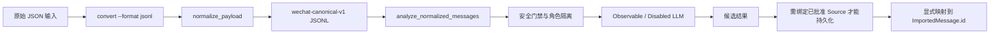

# P3-C：真实来源契约与候选画像闭环

作者：valen MPF
日期：2026-10-17（Asia/Shanghai）

## 1. 执行状态

本报告区分代码事实、合成测试结果和未执行事项。测试数据均为测试内人工构造的合成记录；本阶段没有读取真实导出文件，没有运行真实画像分析，也没有执行浏览器实测或真实 LLM。

执行前分支为 `feature/p2b-workspace-updates`，HEAD 为 `b008fd6e1b8e9f48fcc514c181e368c4ff40a953`，与 `origin/feature/p2b-workspace-updates` 一致。工作区在本阶段开始前已包含 P3-C 的未提交修改和未跟踪文件；这些改动全部保留。本阶段仅修正新增测试中的 Ruff 空行格式，并更新规划、进度、发现记录和本报告；没有提交或推送。

执行边界：未访问/枚举 `data/`、`data/inbox/`；未连接业务数据库、执行真实迁移、外发数据、调用外部服务或安装依赖。`backend/tests/test_imports.py` 的静态检查发现测试会写入并扫描仓库 Inbox 目录，故未运行。

## 2. 数据流与字段契约

### JSONL 路径

`scripts/convert_wechatauto_export.py` 的 JSONL 输出调用 `normalize_payload()`。分析服务接收内存中的规范化记录；受控持久化函数还要求已批准的数据库来源以及显式 sender-role 映射。当前没有接受任意 JSONL 上传并自动创建可信导入来源的 API。`POST /api/candidate/sources/{source_id}/analyze` 从已批准 Source 的 ImportedMessage 重建 canonical records，而不是信任调用方提交的摘要或映射。

### ZIP/Inbox 路径

```mermaid
flowchart LR
    A[原始 JSON 输入] --> B[convert ZIP]
    B --> C[normalize_payload]
    C --> D[messages.json + canonical metadata]
    D --> E[parse_archive]
    E --> F[Inbox Source 待审核]
    F --> G[人工 sender-role 映射与 approve]
    G --> H[ImportedMessage + metadata_json]
    H --> I[approved-source analyze API]
    I --> J[候选持久化与后续审核/准入]
```

`convert()` 在生成 ZIP 时复用 canonical 规范化结果，保留原有 `external_id` 格式，并将 canonical ID、时间/类型状态及安全审计值写入 ZIP 消息 metadata。`parse_archive()` 保留 metadata 并对 JSONL 的 `message_id` 设置 canonical ID。`api/imports.py::approve_import()` 将归档解析结果的 metadata 原样写入 `ImportedMessage.metadata_json`。P3-C 合成测试覆盖 converter → parser → 隔离数据库/候选闭环；由于 `test_imports.py` 固定使用仓库 Inbox，本阶段没有运行完整 Inbox HTTP 上传/批准路径。

### Canonical 核心字段

| 字段 | canonical 来源/语义 | 缺失或冲突行为 | 用途/限制 |
|---|---|---|---|
| `canonical_contract_version` | `wechat-canonical-v1` | 版本缺失或不符时，受控入口拒绝或将旧 ImportedMessage 的来源字段标为 unknown | 限定当前来源契约版本 |
| `message_id` | 规范化来源 ID；ZIP 同时保留不同语义的 `external_id` | 无法获得稳定 ID 或重复时拒绝/不参与证据 | 不能作为 `ImportedMessage.id` |
| `sender` / `speaker_role_id` | 消息发送方；角色由人工/显式映射提供 | sender 未映射、同名角色映射矛盾时拒绝 | 不按昵称猜测角色 |
| `message_type` / `source_type_code` | 原始类型经规范化后的类型及类型码 | 未知类型不会据此推断 AI/system；非 text 不进入普通文本分析 | 类型用于内容资格和来源核对 |
| `content` / `content_status` | 原始消息正文及 present/empty/missing/not_text 状态 | 空、缺失、非文本不作为普通文本证据 | 输入摘要只存正文哈希，不把正文放入摘要字段 |
| `timestamp` / `timestamp_status` | UTC 时间及 parsed/missing/invalid/out_of_range 状态 | 无效/缺失时间保留状态，不伪造时间特征 | 仅有效时间戳用于时序证据 |
| `is_ai_generated` / `is_system` | `derive_security_flags()` 输出 `bool | None` | 非法、缺失、冲突来源保持 unknown；不是默认 False | 两项均明确为 False 才能进入普通文本门禁 |
| `security_flag_inputs` | 分开保留顶层字段与原始 `source_metadata` 的类型/布尔输入 | 缺失、格式不符或不一致时拒绝 | 用于重新计算并审计来源 |
| `security_flag_sources` | 每个安全值的稳定判定来源 | 与重新计算结果不一致时拒绝 | 不可只保存最终值而丢弃依据 |
| `ImportedMessage.id` | 导入数据库生成的正式 UUID | 不从 JSONL ID 推导 | 候选证据必须通过显式映射建立外键 |

安全标记只使用明确布尔字段和可靠类型标记；普通文本、昵称或 `text` 类型不能证明“不是 AI/system”。显式来源矛盾的安全值为 unknown。分析门禁重新运行 `derive_security_flags()` 并核对 `security_flag_sources`，缺失或冲突来源不会因 truthiness 转换而通过。

## 3. 受控来源、映射和候选生成

`source_contract.py` 增加受控服务边界：

- 只接受当前 canonical contract 和唯一 `message_id`；sender 必须在调用方显式角色映射中，角色限于 `role_a`/`role_b`。
- `input_digest` 由稳定排序的 canonical 字段计算，正文只参与 SHA-256，不存入摘要。角色范围纳入持久化快照摘要；数据集身份使用已批准 `Source.id`。
- `analyzer_digest` 由实际 analyzer 名称、版本、各角色运行状态及 Observable 配置生成，不接受外部随意传入的可信摘要。
- ID 映射只在同一已批准 Source 的 ImportedMessage 中解析；优先检查 `external_id` 和 `canonical_message_id`，必须唯一，并核对角色、sender、canonical 版本、消息类型、安全审计、present 正文和有效时间戳。缺失、歧义、冲突映射保留为 unmatched/invalid 原因，不当作 supporting evidence。
- `source_dataset_id` 与 `ImportedMessage.id` 保持不同字段和不同用途。候选外键只写显式映射结果。
- 同一来源、输入摘要、角色范围和 analyzer 摘要重试会复用既有快照；变更输入/角色范围/analyzer 身份产生不同快照身份。

受控分析明确使用 `ObservableAnalyzer` 和 `DisabledLLMSemanticAnalyzer`。Observable 生成可解释的消息长度、问句、标点、emoji、口语表达统计；样本不足返回 `insufficient_samples`。Disabled LLM 仅返回 `provider_disabled`。通用分析器列表中的 `FakeSemanticAnalyzer` 是词项规则测试替身，不是语义理解模型；本阶段没有将其用于受控生产分析。

## 4. 审核、置信度、准入和消费闭环

- Analyzer 的原始置信度仍允许 `NULL`。新增候选 `reviewer_confidence`，审核人必须显式提供 0–1 有限数值及审核说明；只允许随接受操作设置。审核服务以乐观并发条件更新候选，并在同一事务追加带置信度前后值的 ReviewEvent；Analyzer 值不被覆盖。
- Migration `0006_candidate_review_confidence` 为候选项和审核事件添加 nullable 置信度及范围约束；`0007_profile_confidence_source` 为正式特征添加 `confidence_source`，区分 `analyzer_measurement` / `reviewer_assessed`。
- 正式准入要求候选 accepted、认知状态已知、无冲突、置信度已确定、有 matched supporting evidence、无 counter evidence，并重新核对消息角色和 Source approved。准入只创建 `draft ProfileVersion`，不是直接发布。
- 正式特征仍需通过既有 trait 审核和 publish 流程。消费接口仅读取 approved 版本中 accepted、无冲突、有置信度且认知状态受支持的特征；证据还需能连接到同角色 ImportedMessage 和 approved Source。无可用版本返回 `insufficient_samples`；有版本但无可用特征返回 `partial`。
- `invalidate_imported_message_evidence()` 将删除前的 matched 候选映射改为 invalid；数据库外键使用 `ON DELETE RESTRICT`。当前未发现消息删除 API 调用此 helper，正式数据删除入口/事务编排仍需后续明确。Source 撤销后，准入和消费查询会检查 approved 状态；本阶段没有真实撤销操作或浏览器轮次实测。

合成测试实际执行候选快照 → reviewer confidence → candidate admission draft → 正式 trait 审核 → publish → role context 查询。没有任何测试把候选 accepted 等同正式发布。

## 5. 实际执行的测试与检查

工作目录为 `G:\\codex\\wechat-character-lab`，使用已有 `backend\\.venv` 和仓库已有前端依赖；未安装依赖。

| 命令 | 实际结果 |
|---|---|
| `backend\\.venv\\Scripts\\python.exe -m pytest -q backend/tests/test_p3c_source_contract.py backend/tests/test_converter_bom.py backend/tests/test_m1_profile_engine.py backend/tests/test_migrations.py` | 17 passed, 6 warnings，退出码 0。包含 JSONL/ZIP 合成契约、映射/幂等、候选审核准入发布/消费和隔离 SQLite migration 测试。 |
| `backend\\.venv\\Scripts\\python.exe -m pytest -q backend\\tests --ignore=backend\\tests\\test_imports.py` | 116 passed, 6 warnings，退出码 0；这是排除 Inbox 扫描测试的受限后端回归，不代表执行了全量导入测试。 |
| `backend\\.venv\\Scripts\\ruff.exe check backend scripts/convert_wechatauto_export.py` | All checks passed，退出码 0。 |
| `pnpm run typecheck`（`frontend/`） | 退出码 0。 |
| `pnpm run build`（`frontend/`） | Vite production build 成功，退出码 0。 |
| `git diff --check` | 初始执行通过；报告完成后还会再执行一次最终检查。 |

定向 Ruff 第一次运行发现 `test_p3c_source_contract.py` 的空行格式问题；按 Ruff diff 指示修正后，定向 Ruff 与上表全范围检查均通过。六条测试告警来自 Starlette/httpx、pytest-asyncio 与 Alembic 的既有弃用提示。migration 测试使用 `tmp_path` 下的临时 SQLite 文件；Alembic SQLite 迁移连接开启 foreign keys。业务 ORM 测试使用 `test_session_factory`，该夹具显式执行 `PRAGMA foreign_keys=ON`。migration 外键专项检查读取 schema 元数据，不等同于实际删除记录测试。没有访问默认业务数据库。

## 6. 真实来源与外部 Analyzer 状态

| 项目 | 结果 |
|---|---|
| 真实导出转换、脱敏统计、角色映射和人工抽查 | 未执行：本阶段没有明确选定的单个来源文件路径/范围及授权证明；未枚举数据目录。 |
| 真实来源候选分析、审核、准入、发布 | 未执行；不能以合成闭环代替真实样本结论。 |
| 真实画像驱动浏览器验收 | 未执行；本阶段只通过合成 API 测试验证 context，不报告浏览器通过。 |
| Chat2Profile / ChatAnalysis.SKILL | 本阶段未下载、安装或执行。既有 `reports/p2-tool-audit.md` 是静态来源/依赖审查记录，不是本阶段可运行验证。 |
| 外部 LLM | Disabled Provider 保持关闭；没有向外发送数据。 |
| ASR/TTS/GPT-SoVITS | 不属于本阶段执行范围；未调用。 |

`backend/tests/test_imports.py` 会在仓库 `data/inbox/` 写入 ZIP、调用 Inbox 全目录扫描并删除测试文件。该测试不满足当前执行边界，故跳过；其余合成归档解析通过 `tmp_path` 覆盖。原始聊天数据、媒体、凭据和完整消息 ID 未进入本报告或 Git。

## 7. 修改文件与 Git 状态

本阶段提交前没有进行 stage/commit/push。现有改动分组如下（均保留）：

- Canonical/导入：`scripts/convert_wechatauto_export.py`、`backend/app/ingestion/wechat_normalizer.py`、`backend/app/ingestion/archive_parser.py`。
- 受控服务和 API：`backend/app/profiles/source_contract.py`（新增）、`backend/app/profiles/candidate_persistence.py`、`backend/app/api/candidates.py`。
- 置信度、审核、准入、消费：`backend/app/models/candidates.py`、`backend/app/models/profiles.py`、`backend/app/profiles/candidate_review.py`、`backend/app/profiles/admission.py`、`backend/app/profiles/consumer.py`、`backend/app/profiles/service.py`、`backend/app/api/profiles.py`、`backend/app/schemas/candidates.py`、`backend/app/schemas/profile.py`、`frontend/src/types.ts`。
- Migration：`backend/alembic/versions/0006_candidate_review_confidence.py`、`backend/alembic/versions/0007_profile_confidence_source.py`（新增）。
- 测试：`backend/tests/test_p3c_source_contract.py`（新增）、`backend/tests/test_converter_bom.py`、`backend/tests/test_m1_profile_engine.py`。
- 规划记录：`task_plan.md`、`findings.md`、`progress.md`。
- 交付报告：`reports/p3-c-real-source-candidate-closure.md`（本文件）。

最终 Git 状态：`feature/p2b-workspace-updates`，HEAD 仍为 `b008fd6e1b8e9f48fcc514c181e368c4ff40a953`，跟踪关系显示与 `origin/feature/p2b-workspace-updates` 一致；20 个已跟踪文件修改、5 个新增文件未跟踪（含本报告）。最终 `git diff --check` 退出码 0。Git 提示若后续更新部分文件将进行 LF→CRLF 转换；本次没有重写换行格式。所有修改均未暂存/提交/推送。

## 8. 未解决问题与建议

1. 需由用户显式选择并确认获授权的单个真实导出样本；之后才能执行只读转换、隔离导入、角色映射和人工脱敏核对。未授权前不得继续真实候选生命周期。
2. 没有直接 JSONL 上传/注册来源 API；当前持久化入口要求先有已批准 Source 与对应 ImportedMessage。若产品需要 JSONL 直入，应先设计来源登记和数据映射审批，而非绕过来源契约。
3. 当前 P3-C 测试覆盖 converter/parser 和隔离候选闭环，但不执行 Inbox HTTP 上传/审批；建议把 Inbox 根目录做为显式依赖注入，再对临时目录跑完整导入 API 集成测试。
4. Migration 测试覆盖隔离数据库从初始 revision 升至 head、候选外键与 schema；尚无“0005 已有候选数据时升级 0006/0007 并降级后逐行检查数据保留”的专项回归。虽然新增列为 nullable 或带 server default，本项仍应补测。
5. `invalidate_imported_message_evidence()` 目前没有生产删除流程调用方。若新增消息删除功能，必须在同一事务先失效证据，再删除正式消息；当前 RESTRICT 约束仍是最后保护。
6. Analyzer 当前只提供确定性 Observable 统计；它不支持可靠的关系/性格语义推断。真实 Analyzer 接入需先固定来源/许可证/依赖、输出 schema、证据回指验证和隐私边界。
7. 本阶段无真实数据、真实模型或浏览器测试结果；不应把合成测试通过描述成完整的真实画像验证。

本阶段到此停止，等待人工 Review；未提交、未推送，也未开始下一阶段。
